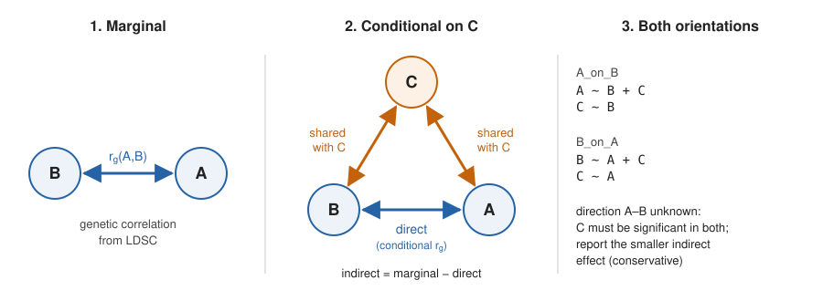
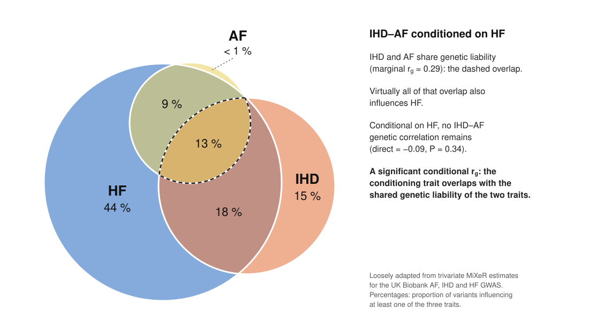

# Conditional genetic correlations with Genomic SEM

Does the genetic correlation between two traits change when we account for the genetic liability of a third
trait? This repository contains the code and a step-by-step tutorial for the conditional genetic correlation
analyses in:

* Romero C, Wightman D, Jurgens SJ, et al. *Mapping the genetic landscape of eight common cardiovascular
  diseases.* medRxiv 2026. doi:[10.64898/2026.04.26.26351760](https://doi.org/10.64898/2026.04.26.26351760)
* Romero C, Shadrin AA, Parker N, et al. *Sex differences in genetic pathways underlying ischaemic heart
  disease–depression comorbidity.* medRxiv 2026.
  doi:[10.64898/2026.04.29.26352017](https://doi.org/10.64898/2026.04.29.26352017)

The test used here is derived in Supplementary Note 7 of Romero C, de Leeuw C, Schipper M, et al.
*Immune-developmental processes contribute to schizophrenia risk: insights from a genetic overlap study with
height.* Biol Psychiatry 2025 ([article](https://www.biologicalpsychiatryjournal.com/article/S0006-3223(25)01018-2/fulltext)).

**Contents:** [Application](#application) · [The model](#the-model) ·
[Conditional r<sub>g</sub> significance testing](#conditional-rg-significance-testing) ·
[Workflow and decisions](#workflow-and-decisions) · [Test run](#test-run-does-the-genetic-overlap-between-ihd-and-af-also-overlap-with-hf-or-with-height) ·
[Reading the output](#reading-the-output) · [Interpreting results](#interpreting-results) ·
[Scaling up](#scaling-up-many-pairs-and-many-conditioning-traits-in-batches)

---

## Application

Two diseases A and B are genetically correlated (r<sub>g</sub>). Part of that correlation may exist because both
share genetic liability with a third trait C, such as body mass index or another disease. We compare:

* the **marginal** r<sub>g</sub>(A,B): the genetic correlation from LDSC, and
* the **direct** (conditional) association between A and B when the genetic liability of the conditioning
  trait C is in the model.

If the direct estimate is clearly different from the marginal one, the genetic signal of C overlaps with the
genetic signal that A and B share. We call the difference the *indirect* effect of C. The analysis describes
overlap of genetic liability, not a causal pathway (see [Interpreting results](#interpreting-results)).

## The model

<p align="center"></p>

All three relationships are genetic covariances, so the arrows are double-headed. To split the A–B covariance
into a part shared with C and a part that is not, Genomic SEM fits a regression on the genetic covariance
matrix. A regression needs an outcome, but we do not know which of A and B should be the outcome, so every
model is fitted in **both orientations** (see [Why both orientations](#why-both-orientations)):

```
A_on_B:   A ~ B + C      B_on_A:   B ~ A + C
          C ~ B                    C ~ A
```

From the standardised estimates of one orientation (here `A_on_B`):

| | Path | Column |
|---|---|---|
| marginal | r<sub>g</sub>(A,B), no C in the model | `marginal_rg` |
| direct | A ~ B, with C in the model | `direct` |
| conditioning effect | A ~ C, with B in the model | `conditioning_effect`, `conditioning_p` |
| conditioning–predictor effect | C ~ B | `conditioning_predictor_effect`, `conditioning_predictor_p` |
| indirect | marginal − direct = (C ~ B) × (A ~ C) | `indirect` |
| ratio | indirect / marginal: proportion of r<sub>g</sub> shared with C | `ratio` |

## Conditional r<sub>g</sub> significance testing

We want a p-value for *marginal − direct*. Supplementary Note 7 of Romero et al. (2025) shows that this
difference does not need its own test. For predictors X<sub>1</sub> (here B) and X<sub>2</sub> (here C) and
outcome Y (here A):

$$\beta_1 - \beta_{1|2} \;=\; \frac{\mathrm{Cov}(X_1, X_2)}{\mathrm{Var}(X_1)}\,\beta_{2|1}$$

* β<sub>1</sub> is the marginal effect of B on A, β<sub>1|2</sub> the direct effect given C;
* Cov(X<sub>1</sub>,X<sub>2</sub>)/Var(X<sub>1</sub>) is the regression of C on B (`conditioning_predictor_effect`);
* β<sub>2|1</sub> is the effect of C on A given B (`conditioning_effect`).

So the difference is zero if, and only if, C is unrelated to B (Cov(X<sub>1</sub>,X<sub>2</sub>) = 0) **or** C
has no effect on A once B is in the model (β<sub>2|1</sub> = 0). When C is genetically correlated with B,
testing "direct = marginal" is the same as testing β<sub>2|1</sub> = 0. **The p-value of the conditioning trait
in the model with both predictors (`conditioning_p`) is the p-value for the change from marginal to direct
r<sub>g</sub>.**

Two decisions follow directly:

1. Only test conditioning traits that are genetically correlated with the predictor
   (`conditioning_predictor_p < 0.01`); otherwise `conditioning_p` does not test the change. Because both
   orientations are fitted, this means C must be correlated with both A and B.
2. Report the indirect effect, `marginal − direct`, as the size of the change, and `conditioning_p` as its
   significance.

## Workflow and decisions

| Step | What | Decision | Why |
|---|---|---|---|
| 0 | Munge summary statistics | `GenomicSEM::munge()`, as on the [Genomic SEM wiki](https://github.com/GenomicSEM/GenomicSEM/wiki) | consistent alleles and SNP set |
| 1 | Multivariable LDSC on A, B and all conditioning traits | many conditioning traits: batches of ~50 (see [Scaling up](#scaling-up-many-pairs-and-many-conditioning-traits-in-batches)) | the LDSC sampling covariance matrix grows with the 4th power of the number of traits |
| 2 | Choose pairs | pairs with a significant marginal r<sub>g</sub> | necessary for estimating the indirect effect of the conditioning trait |
| 3 | Fit `conditional_rg()` for every pair × conditioning trait | both orientations | direction between A and B is unknown |
| 4 | Eligible conditioning traits | `conditioning_predictor_p < 0.01` in both orientations (C correlated with A and with B) | required for `conditioning_p` to test the change |
| 5 | Significant conditioning trait | `conditioning_p < alpha` in **both** orientations | the result must not depend on which trait is the outcome |
| 6 | Size of the effect | report the orientation with the **smaller indirect effect** | conservative minimum when direction is unknown |
| 7 | Direction of the change | keep `ratio > 0`; flag `ratio < 0` as a suppressor | a significant change can also be an *increase* in r<sub>g</sub> |

Steps 4–7 are `summarise_conditional()`; `alpha` is the significance threshold you choose for `conditioning_p`.

## Requirements

* R (≥ 4.1) with Genomic SEM:
  ```r
  install.packages("devtools")
  devtools::install_github("GenomicSEM/GenomicSEM")
  install.packages("future.apply")   # optional, for parallel runs
  ```
* Munged summary statistics, one `.sumstats.gz` file per trait (Genomic SEM wiki).
* The European LD scores used by Genomic SEM (`eur_w_ld_chr/`, linked from the Genomic SEM wiki), placed in
  `ld/eur_w_ld_chr/` in this repository.

## Test run: does the genetic overlap between IHD and AF also overlap with HF, or with height?

```bash
Rscript example/run_example.R
```

This takes about a minute. It uses UK Biobank GWAS of ischaemic heart disease (IHD), atrial fibrillation (AF)
and heart failure (HF) from the 8-CVD paper, and a UK Biobank GWAS of height (Neale lab). The pair is IHD~AF
(A = IHD, B = AF); the conditioning traits are HF and height. The output below is copied from the run.

### Step 1. Marginal genetic correlations

```
        UKB_IHD UKB_AF UKB_HF height
UKB_IHD    1.00   0.29   0.65  -0.12
UKB_AF     0.29   1.00   0.55   0.16
UKB_HF     0.65   0.55   1.00  -0.01
height    -0.12   0.16  -0.01   1.00
```

IHD and AF have r<sub>g</sub> = 0.29. HF is strongly correlated with both (0.65 and 0.55), so it may overlap
with the genetic liability that IHD and AF share. Height is weakly correlated with both, but in opposite
directions: negatively with IHD, positively with AF.

### Step 2. Conditional models

```
 direction conditioning_trait marginal_rg  direct direct_se direct_p conditioning_p conditioning_predictor_p
    A_on_B             UKB_HF       0.293 -0.0882    0.0923 3.39e-01       1.67e-07                 6.36e-21
    B_on_A             UKB_HF       0.293 -0.1073    0.1160 3.55e-01       4.95e-05                 3.52e-29
    A_on_B             height       0.293  0.3216    0.0385 6.27e-17       2.06e-14                 8.45e-12
    B_on_A             height       0.293  0.3180    0.0381 7.42e-17       1.08e-16                 3.67e-08

 direction conditioning_trait indirect indirect_se total   ratio
    A_on_B             UKB_HF   0.3812     0.08342 0.293  1.3009
    B_on_A             UKB_HF   0.4003     0.10492 0.293  1.3661
    A_on_B             height  -0.0286     0.00561 0.293 -0.0976
    B_on_A             height  -0.0249     0.00544 0.293 -0.0851
```

`A_on_B` is `IHD ~ AF + C, C ~ AF`; `B_on_A` is `AF ~ IHD + C, C ~ IHD`. Note that `total` (direct + indirect)
equals the marginal r<sub>g</sub> in every row, as the derivation above requires.

**HF.** With HF in the model, the IHD–AF association drops from 0.29 to about −0.09 (`direct`), which is not
different from zero (`direct_p` = 0.34). The change is highly significant (`conditioning_p` =
1.7 × 10<sup>−7</sup>), and HF is clearly correlated with the predictor (`conditioning_predictor_p` =
6 × 10<sup>−21</sup>), so this p-value tests the change. Both IHD–AF | HF and AF–IHD | HF are significant. The
indirect effect (0.38) is larger than the marginal r<sub>g</sub>, giving a ratio of 1.30: the attenuation is
complete, and the small negative remainder is well within its standard error (0.09). Ratios above 1 are
therefore read as complete attenuation (they were shown as 100% in the paper's figures).

**Height.** With height in the model, the IHD–AF association goes *up*, from 0.29 to 0.32. `conditioning_p`
is very small (2 × 10<sup>−14</sup>): the change is real, but it is an increase. Because height is genetically
correlated positively with AF and negatively with IHD, it masks part of the IHD–AF correlation instead of
overlapping with their shared liability. The indirect effect and the ratio are negative (−0.03, −10%). Height
is a **suppressor** here.

### Step 3. Decisions (`summarise_conditional()`)

```
 direction conditioning_trait conditioning_predictor_p eligible conditioning_p significant
    A_on_B             UKB_HF                 6.36e-21     TRUE       1.67e-07        TRUE
    B_on_A             UKB_HF                 3.52e-29     TRUE       4.95e-05        TRUE
    A_on_B             height                 8.45e-12     TRUE       2.06e-14        TRUE
    B_on_A             height                 3.67e-08     TRUE       1.08e-16        TRUE
```

* **Eligible:** both conditioning traits are genetically correlated with both IHD and AF
  (`conditioning_predictor_p < 0.01` in both orientations).
* **Significant:** both have `conditioning_p < 0.05` in both orientations.
* **Conservative orientation:** for HF, `A_on_B` has the smaller indirect effect (0.381 vs 0.400), so that row
  is reported.
* **Direction of the change:** height has a negative ratio and is dropped as a suppressor.

Result:

```
           pair conditioning_trait direction marginal_rg  direct direct_p indirect ratio conditioning_p
 UKB_IHD~UKB_AF             UKB_HF    A_on_B       0.293 -0.0882    0.339    0.381   1.3       1.67e-07
```

**Conclusion:** the genetic overlap between IHD and AF also overlaps with the genetic liability of HF;
conditional on HF, no IHD–AF genetic correlation remains. Height changes the correlation significantly, but in
the opposite direction, so it does not overlap with the shared liability of IHD and AF.

This matches the IHD~AF / Heart Failure row of Supplementary Table 25 in the 8-CVD paper (direct −0.09,
p-value of the conditioning trait 2.4 × 10<sup>−7</sup>, indirect 0.38, ratio 1.30). The small differences come
from running LDSC on these four traits only, instead of in a batch with the other CVDs and conditioning traits.

## Reading the output

`conditional_rg()` returns one row per conditioning trait × orientation; `summarise_conditional()` adds the
decision columns.

| Column | Meaning |
|---|---|
| `pair` | the two traits, `A~B` |
| `direction` | `A_on_B`: A is the outcome, B the predictor; `B_on_A` the reverse |
| `conditioning_trait` | the trait conditioned on (C) |
| `marginal_rg` | r<sub>g</sub>(A,B) from LDSC |
| `direct`, `direct_se`, `direct_p` | outcome ~ predictor with C in the model (conditional r<sub>g</sub>) |
| `conditioning_effect`, `conditioning_se`, `conditioning_p` | outcome ~ C with the predictor in the model; **`conditioning_p` tests direct = marginal** |
| `conditioning_predictor_effect`, `_se`, `conditioning_predictor_p` | C ~ predictor; must be significant for `conditioning_p` to test the change |
| `indirect`, `indirect_se` | marginal − direct; SE by the delta method |
| `total` | direct + indirect (equals `marginal_rg`) |
| `ratio` | indirect / total, the proportion of r<sub>g</sub> shared with C |
| `eligible` | C correlated with both traits (`conditioning_predictor_p < 0.01` in both orientations) |
| `significant` | eligible and `conditioning_p < alpha` in this orientation |
| `suppressor` | `ratio < 0` (only in the summary table) |

## Interpreting results

### Intuition

<p align="center"></p>

**A significant conditional r<sub>g</sub> means that the conditioning trait overlaps with the shared genetic
liability of the two traits.** The figure gives the intuition for the test run. It is loosely adapted from
trivariate MiXeR ([Shadrin et al. 2025](https://doi.org/10.1186/s13073-025-01528-3);
[github.com/precimed/mix3r](https://github.com/precimed/mix3r)), which estimates how many trait-influencing
variants are unique to each of three traits, shared by two, or shared by all three. For UK Biobank AF, IHD and
HF, virtually all variants that influence both AF and IHD (dashed outline) also influence HF. Conditioning the
IHD–AF genetic correlation on HF therefore leaves nothing of it.

MiXeR counts shared variants regardless of the direction of their effects, whereas r<sub>g</sub> reflects how
consistently those effects align. The figure illustrates the idea; it is not a one-to-one translation of the
conditional estimates.

### Why both orientations

The regression needs one trait of the pair as the outcome, and the result can depend on that choice.

* **No temporal structure.** GWAS associations carry no information on which trait comes first, and many
  traits influence each other in both directions. Choosing IHD or AF as the outcome would assume a causal
  direction that the data cannot support. Fitting both orientations avoids building that assumption into the
  result and guards against reading it as a causal pathway.
* **The choice can change the estimate.** The indirect effect tends to look larger when the outcome is the
  trait most strongly correlated with the conditioning trait, and smaller when the model is reversed. A large
  estimate in one orientation can then reflect a strong link between the conditioning trait and one of the two
  traits, rather than overlap with their shared liability.

We therefore fit both orientations, require the conditioning trait to be significant in both, and report the
smaller indirect effect as a conservative estimate (see also Supplementary Note 3 of Romero et al., *Sex
differences in genetic pathways underlying ischaemic heart disease–depression comorbidity*). In the test run,
both IHD–AF | HF and AF–IHD | HF are significant and give similar indirect effects (0.38 and 0.40).

### Notes

* **Significance and size are separate.** `conditioning_p` says whether r<sub>g</sub> changes; `ratio` says by
  how much. With well-powered GWAS a conditioning trait can be highly significant with a ratio of a few
  percent (the significant metabolites in the 8-CVD paper had a median ratio of 9%).
* **Ratio near or above 1** means complete attenuation: nothing of the A–B genetic correlation is left beyond
  what is shared with C. Check `direct_p`; a ratio above 1 with a non-significant `direct` is complete
  attenuation, not over-explanation.
* **Negative ratio** means C masks part of the correlation (suppression). Report such results separately if
  they are of interest, but not as overlap with the shared liability of A and B.
* **Not causal.** The models partition genetic covariance. A conditioning trait that overlaps with the shared
  liability of A and B is compatible with genetic liability to C affecting both A and B, with A or B affecting
  C, or with variants that affect all three. In the 8-CVD paper, for example, conditioning on HF removed the IHD–AF
  genetic correlation; this is compatible with liability to one CVD increasing susceptibility to others
  (vertical pleiotropy), but the analysis cannot exclude the same variants acting on each disease
  independently.
* **Sample overlap** between GWAS, including shared controls, is accounted for by LDSC through the
  cross-trait intercept.
* **Scale.** `sample.prev` and `population.prev` are `NA` (observed scale). All estimates here are
  standardised, so converting to the liability scale does not change them.
* **Local analyses.** The same test applies to local genetic correlations; Supplementary Note 7 derives it
  for conditional analyses in LAVA.

## Scaling up: many pairs and many conditioning traits, in batches

In the 8-CVD paper, 15 CVD pairs were each conditioned on the other CVDs and on 288 further traits (risk
factors, biomarkers and metabolites). `analysis/run_all_batches.R` does this.

**1. LDSC in batches.** LDSC estimates a covariance for every pair of traits plus the sampling covariance of
all those estimates. With *k* traits that matrix has [*k*(*k*+1)/2]² entries, so it grows with the fourth power
of *k*:

| Traits in one LDSC run | (Co)variances | Sampling covariance matrix |
|---|---|---|
| 8 CVDs + 50 conditioning traits = 58 | 1,711 | ~3 million entries (~23 MB) |
| 8 CVDs + 288 conditioning traits = 296 | 43,956 | ~1.9 billion entries (~15 GB) |

The script puts all **core traits** (the 8 CVD GWAS whose pairs are analysed) in every batch and adds the
**conditioning traits** 50 at a time. Each model needs only three traits (A, B and C), and those three are
always together in at least one batch.

**2. Models per batch.** For every batch, every pair is conditioned on every conditioning trait in that
batch, in both orientations. The other CVDs are also used as conditioning traits (e.g. HF for
`UKB_IHD~UKB_AF`); they are in every batch, so this is done once, in batch 1. Results go to one CSV per batch
and pair.

**3. Decisions.** All CSVs are combined and `summarise_conditional()` applies steps 4–7 of the workflow.

Output in `results/`:

| File | Content |
|---|---|
| `all_conditional_results.csv` | every pair × conditioning trait × orientation, with `eligible` and `significant` |
| `significant_conditioning_traits.csv` | significant conditioning traits, one row per pair, in the conservative orientation |

### Running it

Edit the CONFIG block at the top of `analysis/run_all_batches.R`: folders with core and conditioning-trait
summary statistics, the pairs, whether the core traits are also used as conditioning traits, the significance
threshold `alpha`, batch size and number of parallel workers. Then:

```bash
Rscript analysis/run_all_batches.R
```

* **Restarting.** Finished LDSC batches and pair files are skipped on a re-run, so an interrupted run
  continues where it stopped.
* **Parallel models.** `workers` fits conditioning traits side by side within a pair (via `future.apply`).
  The script limits each process to one BLAS thread, so workers do not compete for cores.
* **On a cluster.** Run one job per batch, e.g. as a SLURM array, then run the script once without a number to
  combine and summarise:
  ```bash
  Rscript analysis/run_all_batches.R ${SLURM_ARRAY_TASK_ID}
  ```
* **Batch size.** About 50 conditioning traits per batch kept each LDSC run and the model fits manageable on a
  laptop. Larger batches mean fewer LDSC runs but larger objects to fit models on.
* **Trait names** come from the file names (`UKB_AF.sumstats.gz` → `UKB_AF`). Characters that lavaan does not
  accept, such as `-`, are replaced by `_`.

## Repository contents

```
R/conditional_rg.R          all functions: LDSC, conditional models, decisions
example/run_example.R       test run: IHD–AF conditioned on HF and on height
example_data/               munged summary statistics for the test run
example_output/             output of the test run
analysis/run_all_batches.R  the full analysis in batches
docs/model.svg              the model figure
docs/intuition.svg          the intuition figure (adapted from trivariate MiXeR)
```

## Example data

* `UKB_IHD`, `UKB_AF`, `UKB_HF`: UK Biobank GWAS from the 8-CVD paper.
* `height`: UK Biobank GWAS of height from the [Neale lab](http://www.nealelab.is/uk-biobank).

## Citation

If you use this code, please cite the papers above and Genomic SEM:

Grotzinger AD, Rhemtulla M, de Vlaming R, et al. Genomic structural equation modelling provides insights into
the multivariate genetic architecture of complex traits. *Nat Hum Behav*. 2019;3:513–525.

The intuition figure is based on trivariate MiXeR:

Shadrin AA, Hindley G, Hagen E, et al. Distinct patterns of genetic overlap among multimorbidities revealed with
trivariate MiXeR. *Genome Med*. 2025;17:106. doi:[10.1186/s13073-025-01528-3](https://doi.org/10.1186/s13073-025-01528-3)
